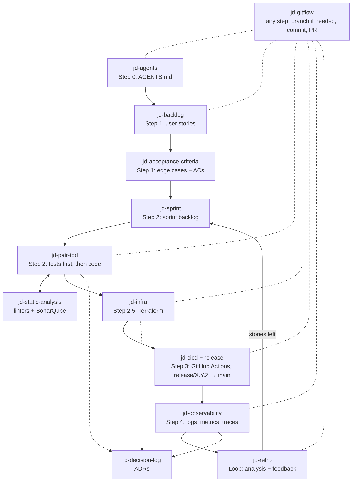

# JuanDevops

Claude Code skills and a subagent for the JuanDevops methodology: SCRUM + DevOps + AI.

The developer is the navigator and has the final word. The agent is the driver: it writes, suggests and warns, but it does not decide.

## Flow



`jd-gitflow` is not a single step: in any step the agent decides whether the work needs a branch, and every merge is a PR (see [Git-flow](#git-flow)).

| Step | Skill | What it does |
|---|---|---|
| 0 | `jd-agents` | Writes `AGENTS.md` for the project: name, docs mode, stack, commands, slice layout, conventions, git-flow and tools in use. `CLAUDE.md` only imports it. |
| 1 | `jd-backlog` | Clarifies the spec, then writes `docs/backlog.md` with a table of user stories: `As a <actor>, I need <capability> for <benefit>`. |
| 1 | `jd-acceptance-criteria` | One doc per story (`docs/user-stories/US-#.md`) with edge cases and ACs: `Given <state>, when <action>, then <result>`. |
| 2 | `jd-sprint` | Prioritizes the backlog, groups stories into features (vertical slices) and writes `docs/sprints/###/backlog.md`. |
| 2 | `jd-pair-tdd` | Pair programming: tests from the ACs first, then code, then refactor. Warns about architecture risks once, then follows the developer. |
| 2 | `jd-static-analysis` | Linters, typecheck, coverage and SonarQube (MCP, optional). Runs only when the developer asks. |
| any | `jd-decision-log` | Records essential technical decisions and their reasons as ADRs in `docs/decisions/`. |
| 2.5 | `jd-infra` | Suggests infrastructure from estimated users, budget and architecture. The developer corrects it. Result: Terraform in `infra/`. Never applies without approval. |
| any | `jd-gitflow` | Git-flow for the whole project: decides when work needs a new `feature/*`, `release/*` or `hotfix/*` branch, Conventional Commits with US and AC ids, a PR for every merge. |
| 3 | `jd-cicd` | GitHub Actions: CI on every git-flow branch, deploy of the release to the infrastructure on merge to `main`. Does not implement DORA metrics; keeps deploys visible to your DORA action, if you use one. |
| 4 | `jd-observability` | Suggests observability tools, checks the app is observable by design, and connects it. |
| loop | `jd-retro` | Analyzes production, DORA and quality data, suggests post-sprint fixes, and writes `retro.md` that the next sprint reads. |

## Docs layout

```
docs/
  backlog.md                  product backlog
  user-stories/US-#.md        story, edge cases, ACs
  sprints/###/backlog.md      sprint backlog
  sprints/###/retro.md        retro and actions for the next sprint
  decisions/ADR-###-*.md      technical decisions
  infrastructure.md           infrastructure and CI/CD
  observability.md            tools, SLOs, alerts, runbooks
```

AC ids are global per project (`AC-1`, `AC-2`, ...), so test names like `test_ac3_rejects_duplicate_email` point to one criterion.

## Git-flow

Git-flow covers the whole project, not only merging. In any step, before changing files, the agent analyzes whether the work needs a new branch, fits the branch in progress, or needs none. It proposes with a reason; you decide.

| Situation | Branch |
|---|---|
| New sprint: a group of stories big enough to be its own use case | new `feature/<feature>` from `develop` |
| Small story or change that extends a feature in progress | that feature's branch |
| Infra, CI/CD or observability work that deserves its own review | new `feature/<topic>` from `develop` |
| Only patching a production bug | `hotfix/X.Y.Z` from `main` |
| Features ready in `develop` and you ask for a release | `release/X.Y.Z` from `develop` |
| Planning docs (committed docs modes) with no branch yet | the first feature branch they belong to |
| Reading, analysis, more work on the current branch | no new branch |

Every merge is a pull request: feature → `develop`, release and hotfix → `main`, then `main` → `develop`. Nothing is committed directly on `main` or `develop`. Commits use Conventional Commits with US and AC ids.

## Optional tools

SonarQube (MCP server), a DORA metrics GitHub Action, the `gh` CLI, Terraform, tflint and observability tools are optional. When a step needs one that is missing, it asks you to add it (and says what it gives) or to go without; both are valid. The answer goes to the `## Tools` section of `AGENTS.md`, so it is asked once, and the step adapts:

| Tool | Without it |
|---|---|
| SonarQube + MCP server | `jd-static-analysis` uses local linters, typecheck and coverage; `jd-cicd` has no Sonar step; `jd-retro` uses local coverage. |
| DORA metrics action | `jd-retro` skips DORA metrics. |
| `gh` CLI | The agent writes the PR title and body; you open the PR on the web. Merges still go through PRs. |
| Terraform, tflint | `jd-infra` writes the Terraform files but cannot validate or plan them. |
| Observability MCPs/CLIs | `jd-retro` asks you for exports or screenshots. |

## Obsidian Vault

Optional. `install.py` asks for your vault:

```
Obsidian Vault path (empty for no Obsidian):
```

The path is saved in the jdharness config. `jdharness install` and `update` write it into the `jd-obsidian-sync` subagent (the repo file only has a `{{OBSIDIAN_VAULT}}` placeholder). With no vault, the subagent is not installed and only the `repo-only` and `none` docs modes are offered. To change the vault, run `install.py` again (or `install.py --vault <dir>` / `--no-vault`), then `jdharness update` in each project.

In `mirror` and `vault-only` modes, the `jd-obsidian-sync` subagent runs in the background after any change in `docs/`. It copies the docs to:

```
<vault>/Projects/<Project>/docs/
```

and adds wikilinks between them: backlog ↔ user stories ↔ ACs ↔ sprints ↔ ADRs ↔ retros. Links are added only in the vault copy; the project's `docs/` stays plain markdown.

`<Project>` comes from `Name` in the project's `AGENTS.md`, or the repo directory name. The folders are created if missing.

### Docs modes

`jd-agents` asks for one of four modes:

| Mode | `docs/` | Obsidian | Needs a vault |
|---|---|---|---|
| `mirror` | committed | copied and linked | yes |
| `vault-only` | local working copy in `.gitignore` | source of truth | yes |
| `repo-only` | committed | no | no |
| `none` | not written | no | no |

In `none` mode, skills show the backlog, stories, sprint plan and retro in the chat, ADRs go in the commit body and PR description, and later steps work from the conversation, tests, commits and PRs, or ask you.

### Model

The subagent uses the `sonnet` alias with medium effort (`model: sonnet`, `effort: medium`), so it follows the latest Sonnet (5.5 today). Change those lines if you want a pinned model id or your plan does not include Sonnet.

## Install

Needs Python 3.8+ (Linux, macOS or Windows) and git. No third-party packages.

### 1. Install the `jdharness` command

```bash
git clone <this-repo-url> juan-devops
cd juan-devops
python3 install.py        # Windows: py install.py
                          # asks: "Obsidian Vault path (empty for no Obsidian):"
```

| OS | Where it goes | PATH |
|---|---|---|
| Linux/macOS | `~/.local/bin/jdharness` (executable copy of `jdharness.py`) | Adds a marked block (`# >>> jdharness >>>`) to the profile of your `$SHELL`: `.zshrc`, `.bashrc` (`.bash_profile` on macOS), fish `conf.d/jdharness.fish`, or `.profile`. Skipped if the folder is already on `PATH`; never added twice. |
| Windows | `%LOCALAPPDATA%\Programs\jdharness\` with `jdharness.py`, `jdharness.cmd` (cmd, PowerShell) and `jdharness` (Git Bash) | Appends the folder to the user `PATH` in the registry and notifies open programs. |

It also saves the clone's location and the vault in `~/.config/jdharness/config.json` (`%APPDATA%\jdharness\config.json` on Windows). Open a new terminal afterwards, and keep the clone where it is: `jdharness` installs from it and `update` pulls it. If you move it, run `install.py` again.

| `install.py` option | Effect |
|---|---|
| `--bin-dir <dir>` | Install somewhere else. |
| `--no-modify-path` | Do not touch `PATH` or shell profiles. |
| `--vault <dir>` | Use this Obsidian Vault without asking. |
| `--no-vault` | No Obsidian, without asking. Without a terminal and without these flags, the saved vault is kept (none on first install). |
| `--uninstall` | Remove the command, its config and the `PATH` entry. Harnesses already installed in projects stay. |

### 2. Install the harness in a project

```bash
cd ~/code/app
jdharness install              # asks: "Add a .claude directory for Claude Code?" [Y/n]
```

| Command | What it does |
|---|---|
| `jdharness install [-p PATH] [--claude\|--no-claude] [-f]` | Copies every skill and agent into `PATH/.agents` (default: current directory). Asks about `.claude` unless you pass a flag; without a terminal the answer is yes. |
| `jdharness update [-p PATH] [--no-pull] [--claude\|--no-claude] [-f]` | Runs `git pull --ff-only` in the clone, replaces the `jdharness` command if it changed and restarts it, then refreshes `.agents` and the `.claude` links. New skills are added, skills removed from the repo are removed. Keeps your `.claude` choice unless you pass a flag. |
| `jdharness remove [-p PATH] [-y]` | Asks first (`-y` skips it) and removes only what it installed. Aliases: `delete`, `uninstall`. |
| `jdharness status [-p PATH]` | Shows what is installed, the repo commit it came from and the vault. |
| `--source <repo>` | On `install`/`update`: use another clone. Also `JDHARNESS_SOURCE=<repo>`. |

### How `.agents` and `.claude` work

`.agents/` is the source of truth. `.claude/` only links to it, one link per skill and per agent, so your own files in `.claude/` stay untouched:

```
<project>/
  .agents/
    .jdharness.json               what was installed, from which repo and commit
    skills/jd-*/SKILL.md
    agents/jd-obsidian-sync.md    only with an Obsidian Vault
  .claude/                        only if you said yes
    skills/jd-*                -> ../../.agents/skills/jd-*
    agents/jd-obsidian-sync.md -> ../../.agents/agents/jd-obsidian-sync.md
```

- Links are relative, so the project can move.
- On Windows without symlink permission (no Developer Mode, not admin), folders get junctions and files get hard links; if those fail too, copies. `jdharness update` recreates them, so run it after editing `.agents` when `status` reports copies.
- Existing paths with the same names that `jdharness` did not install stop `install` and `update` with a list of conflicts; `--force` replaces them.
- `jdharness install -p ~` installs for all projects (`~/.agents` and `~/.claude`).
- `update` overwrites `.agents/` with the repo's files. Make your changes in the clone, not in `.agents/`. If upstream also changes those files, `git pull --ff-only` stops; commit or stash your change and merge it. The vault path is not one of those changes: it comes from `install.py`.

## Tests

Standard library `unittest`, no packages to install:

```bash
python3 -m unittest discover -s tests -v
```

| File | Covers |
|---|---|
| `tests/test_jdharness.py` | `install`, `update`, `remove`, `status`: copies, relative links, the `.claude` prompt, conflicts and `--force`, unrelated files kept, skills added and dropped on update, vault written into agents or agents skipped without a vault (and on update when it changes), Windows junction/hard link/copy fallbacks (simulated). |
| `tests/test_install.py` | Launchers per OS, shell profile block per shell (added once, removed cleanly), Windows registry `PATH` (fake registry), install then uninstall, the vault prompt (quoted paths, missing dirs asked again, empty = no Obsidian), `--vault`/`--no-vault`, saved vault kept without a terminal. |
| `tests/test_end_to_end.py` | Real subprocesses: clone a git remote, `install.py --vault`, `jdharness install` (vault in the subagent), upstream commit, `jdharness update` (pull, self-update, restart), `remove`, `install.py --uninstall`; no vault means no subagent. Also checks every skill has valid frontmatter and at most 80 lines, no machine paths in skills or agents, the four docs modes, syncing tied to the docs mode, every skill uses `jd-gitflow`, and merges go through PRs. |

Every test runs in a temporary `HOME`; none touches your profile, config, registry or projects. On Windows, tests that would edit the real user `PATH` are skipped.

## Start

In a new project, ask Claude to run `jd-agents`, then give it the spec for `jd-backlog`. Each skill ends by suggesting the next one.

## Requirements

- Claude Code
- Python 3.8+ and git (for `install.py`, `jdharness` and git-flow)

Optional (see [Optional tools](#optional-tools); the skills ask when one is missing):

- Obsidian Vault (for `mirror` and `vault-only` docs modes)
- SonarQube and its MCP server (for `jd-static-analysis`, `jd-cicd`, `jd-retro`)
- Terraform, tflint (for `jd-infra`)
- `gh` CLI (for PRs in `jd-gitflow`)
- A DORA metrics GitHub Action of your own (`jd-cicd` does not create one; `jd-retro` reads it)
