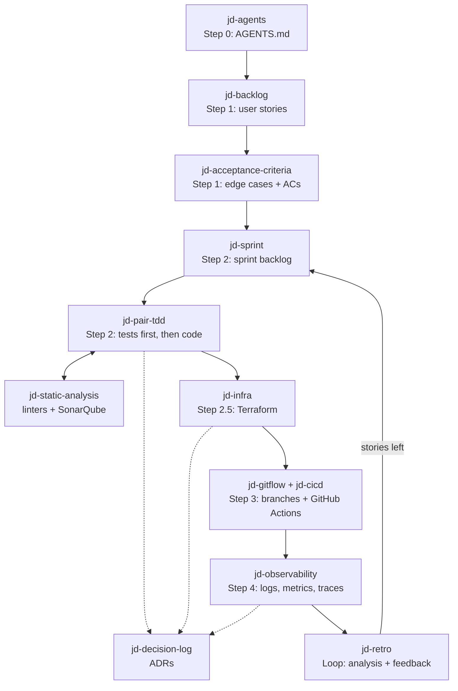

# JuanDevops

Claude Code skills and a subagent for the JuanDevops methodology: SCRUM + DevOps + AI.

The developer is the navigator and has the final word. The agent is the driver: it writes, suggests and warns, but it does not decide.

## Flow



| Step | Skill | What it does |
|---|---|---|
| 0 | `jd-agents` | Writes `AGENTS.md` for the project: name, docs mode, stack, commands, slice layout and conventions. `CLAUDE.md` only imports it. |
| 1 | `jd-backlog` | Clarifies the spec, then writes `docs/backlog.md` with a table of user stories: `As a <actor>, I need <capability> for <benefit>`. |
| 1 | `jd-acceptance-criteria` | One doc per story (`docs/user-stories/US-#.md`) with edge cases and ACs: `Given <state>, when <action>, then <result>`. |
| 2 | `jd-sprint` | Prioritizes the backlog, groups stories into features (vertical slices) and writes `docs/sprints/###/backlog.md`. |
| 2 | `jd-pair-tdd` | Pair programming: tests from the ACs first, then code, then refactor. Warns about architecture risks once, then follows the developer. |
| 2 | `jd-static-analysis` | Linters, typecheck, coverage and SonarQube (MCP). Runs only when the developer asks. |
| any | `jd-decision-log` | Records essential technical decisions and their reasons as ADRs in `docs/decisions/`. |
| 2.5 | `jd-infra` | Suggests infrastructure from estimated users, budget and architecture. The developer corrects it. Result: Terraform in `infra/`. Never applies without approval. |
| 3 | `jd-gitflow` | Git-flow: `feature/*` → `develop` → `release/*` → `main`, plus `hotfix/*`. Conventional Commits that reference US and AC ids. |
| 3 | `jd-cicd` | GitHub Actions: CI on every branch, deploy of the release to the infrastructure on merge to `main`. Does not implement DORA metrics; keeps deploys visible to your existing DORA action. |
| 4 | `jd-observability` | Suggests observability tools, checks the app is observable by design, and connects it. |
| loop | `jd-retro` | Analyzes production, DORA and quality data, suggests post-sprint fixes, and writes `retro.md` that the next sprint reads. |

## Docs layout

```
docs/
  backlog.md                  product backlog
  user-stories/US-#.md        story, edge cases, ACs
  sprints/###/backlog.md      sprint backlog
  sprints/###/retro.md        retro and actions for the next sprint
  decisions/ADR-###-*.md      technical decisions
  infrastructure.md           infrastructure and CI/CD
  observability.md            tools, SLOs, alerts, runbooks
```

AC ids are global per project (`AC-1`, `AC-2`, ...), so test names like `test_ac3_rejects_duplicate_email` point to one criterion.

## Obsidian Vault

The `jd-obsidian-sync` subagent runs in the background after any change in `docs/`. It copies the docs to:

```
<vault>/Projects/<Project>/docs/
```

and adds wikilinks between them: backlog ↔ user stories ↔ ACs ↔ sprints ↔ ADRs ↔ retros. Links are added only in the vault copy; the project's `docs/` stays plain markdown.

**Change the vault path before using it.** The subagent has a hardcoded path that only exists on the author's machine:

```
/home/juandevgo/Documents/Obsidian Vault
```

Open `agents/jd-obsidian-sync.md` and replace that path in the `## Paths` section with the absolute path of your own Obsidian Vault. Keep the path in the same line format; spaces are fine.

`<Project>` comes from `Name` in the project's `AGENTS.md`, or the repo directory name. The folders are created if missing.

### Docs modes

`jd-agents` asks for one of two modes:

- `mirror`: `docs/` is committed to the repo and mirrored to the vault.
- `vault-only`: `docs/` is a local working copy added to `.gitignore`; the vault is the source of truth.

Every skill writes to `docs/` in both modes.

### Model

The subagent uses the `sonnet` alias with medium effort (`model: sonnet`, `effort: medium`), so it follows the latest Sonnet (5.5 today). Change those lines if you want a pinned model id or your plan does not include Sonnet.

## Install

Needs Python 3.8+ (Linux, macOS or Windows) and git. No third-party packages.

### 1. Install the `jdharness` command

```bash
git clone <this-repo-url> juan-devops
cd juan-devops
python3 install.py        # Windows: py install.py
```

| OS | Where it goes | PATH |
|---|---|---|
| Linux/macOS | `~/.local/bin/jdharness` (executable copy of `jdharness.py`) | Adds a marked block (`# >>> jdharness >>>`) to the profile of your `$SHELL`: `.zshrc`, `.bashrc` (`.bash_profile` on macOS), fish `conf.d/jdharness.fish`, or `.profile`. Skipped if the folder is already on `PATH`; never added twice. |
| Windows | `%LOCALAPPDATA%\Programs\jdharness\` with `jdharness.py`, `jdharness.cmd` (cmd, PowerShell) and `jdharness` (Git Bash) | Appends the folder to the user `PATH` in the registry and notifies open programs. |

It also saves the clone's location in `~/.config/jdharness/config.json` (`%APPDATA%\jdharness\config.json` on Windows). Open a new terminal afterwards, and keep the clone where it is: `jdharness` installs from it and `update` pulls it. If you move it, run `install.py` again.

| `install.py` option | Effect |
|---|---|
| `--bin-dir <dir>` | Install somewhere else. |
| `--no-modify-path` | Do not touch `PATH` or shell profiles. |
| `--uninstall` | Remove the command, its config and the `PATH` entry. Harnesses already installed in projects stay. |

### 2. Install the harness in a project

```bash
cd ~/code/app
jdharness install              # asks: "Add a .claude directory for Claude Code?" [Y/n]
```

| Command | What it does |
|---|---|
| `jdharness install [-p PATH] [--claude\|--no-claude] [-f]` | Copies every skill and agent into `PATH/.agents` (default: current directory). Asks about `.claude` unless you pass a flag; without a terminal the answer is yes. |
| `jdharness update [-p PATH] [--no-pull] [--claude\|--no-claude] [-f]` | Runs `git pull --ff-only` in the clone, replaces the `jdharness` command if it changed and restarts it, then refreshes `.agents` and the `.claude` links. New skills are added, skills removed from the repo are removed. Keeps your `.claude` choice unless you pass a flag. |
| `jdharness remove [-p PATH] [-y]` | Asks first (`-y` skips it) and removes only what it installed. Aliases: `delete`, `uninstall`. |
| `jdharness status [-p PATH]` | Shows what is installed and the repo commit it came from. |
| `--source <repo>` | On `install`/`update`: use another clone. Also `JDHARNESS_SOURCE=<repo>`. |

### How `.agents` and `.claude` work

`.agents/` is the source of truth. `.claude/` only links to it, one link per skill and per agent, so your own files in `.claude/` stay untouched:

```
<project>/
  .agents/
    .jdharness.json               what was installed, from which repo and commit
    skills/jd-*/SKILL.md
    agents/jd-obsidian-sync.md
  .claude/                        only if you said yes
    skills/jd-*                -> ../../.agents/skills/jd-*
    agents/jd-obsidian-sync.md -> ../../.agents/agents/jd-obsidian-sync.md
```

- Links are relative, so the project can move.
- On Windows without symlink permission (no Developer Mode, not admin), folders get junctions and files get hard links; if those fail too, copies. `jdharness update` recreates them, so run it after editing `.agents` when `status` reports copies.
- Existing paths with the same names that `jdharness` did not install stop `install` and `update` with a list of conflicts; `--force` replaces them.
- `jdharness install -p ~` installs for all projects (`~/.agents` and `~/.claude`).
- `update` overwrites `.agents/` with the repo's files. Make your changes (like the vault path) in the clone's `agents/jd-obsidian-sync.md`, not in `.agents/`. If upstream also changes that file, `git pull --ff-only` stops; commit or stash your change and merge it.

## Tests

Standard library `unittest`, no packages to install:

```bash
python3 -m unittest discover -s tests -v
```

| File | Covers |
|---|---|
| `tests/test_jdharness.py` | `install`, `update`, `remove`, `status`: copies, relative links, the `.claude` prompt, conflicts and `--force`, unrelated files kept, skills added and dropped on update, Windows junction/hard link/copy fallbacks (simulated). |
| `tests/test_install.py` | Launchers per OS, shell profile block per shell (added once, removed cleanly), Windows registry `PATH` (fake registry), install then uninstall. |
| `tests/test_end_to_end.py` | Real subprocesses: clone a git remote, `install.py`, `jdharness install`, upstream commit, `jdharness update` (pull, self-update, restart), `remove`, `install.py --uninstall`. Also checks every skill has valid frontmatter and at most 80 lines. |

Every test runs in a temporary `HOME`; none touches your profile, config, registry or projects. On Windows, tests that would edit the real user `PATH` are skipped.

## Start

In a new project, ask Claude to run `jd-agents`, then give it the spec for `jd-backlog`. Each skill ends by suggesting the next one.

## Requirements

- Claude Code
- Python 3.8+ and git (for `install.py` and `jdharness`)
- SonarQube MCP server (for `jd-static-analysis`)
- Terraform, tflint (for `jd-infra`)
- `gh` CLI (for `jd-gitflow` PRs)
- A DORA metrics GitHub Action of your own (`jd-cicd` does not create one)
